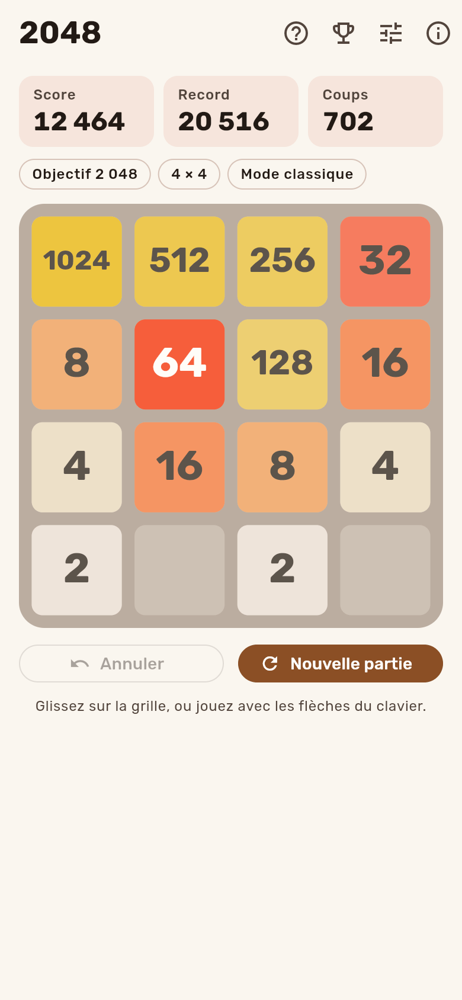
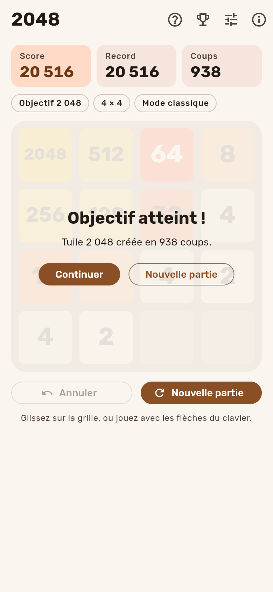
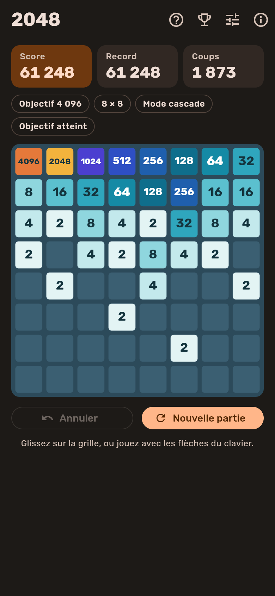

# Jeu 2048 – Flutter

Le jeu 2048 en Flutter : faire glisser les tuiles, fusionner les nombres identiques et atteindre l'objectif. Trois modes de fusion, des objectifs de 256 à 8192, des grilles de 4 × 4 à 8 × 8, l'annulation des coups et des records par type de partie.

C'était le TP Flutter du module Développement mobile, en licence professionnelle DLWM, rendu en décembre 2024. Il n'en restait que le code principal et l'écran des réglages, et plusieurs règles ne fonctionnaient pas : je l'ai repris en entier.

Le jeu se joue [dans le navigateur](https://miscuitatlas.github.io/jeu-2048-flutter/), au doigt ou au clavier (version web publiée sur GitHub Pages).

<table>
  <tr>
    <td></td>
    <td></td>
    <td></td>
  </tr>
</table>

## Les modes de fusion

| Mode | Règle | Exemple vers la gauche |
|---|---|---|
| Classique | Les règles du 2048 original : une tuile ne fusionne qu'une fois par coup. | `2 2 2 2` → `4 4 0 0` |
| Cascade | La variante de l'énoncé du TP : une tuile tout juste fusionnée peut fusionner à nouveau avec sa voisine. | `8 4 2 2` → `16 0 0 0` |
| Express | Deux tuiles identiques donnent une tuile quatre fois plus grande, l'objectif arrive bien plus vite. | `2 2 0 0` → `8 0 0 0` |

Les exemples de l'énoncé servent de tests unitaires au mode cascade.

## Fonctionnalités

- Glissement sur la grille ou flèches du clavier (aussi ZQSD et WASD), annulation des 20 derniers coups.
- Victoire dès que la tuile objectif apparaît, avec le choix de continuer ou de recommencer.
- Records par type de partie (taille, objectif, mode) et reprise de la partie en cours au lancement suivant.
- Réglages : objectif, taille de la grille, mode de fusion, grille de départ aléatoire, trois palettes de couleurs. Thème clair ou sombre selon l'appareil.

**Stack** : Flutter 3.50 et Dart 3.14, `CustomPainter` pour dessiner et animer la grille (demandé par l'énoncé), `shared_preferences` pour les réglages et les records, `flutter_test`.

## Ce que j'ai corrigé

- **Fusion** : les paires ne fusionnaient jamais, seuls quatre nombres identiques alignés se combinaient, et la partie se bloquait très vite. Le mode cascade de l'énoncé n'était pas implémenté.
- **Victoire impossible** : en double fusion, les tuiles pouvaient sauter l'objectif (1024 + 1024 donnait 4096).
- **Fonctions annoncées mais cassées** : le meilleur score était parfois remplacé par le nombre de coups, la grille aléatoire ne remplissait que les 16 premières cases en 8 × 8, et l'option « continuer après la victoire » n'existait pas.
- **Gestes** : un glissement terminé doigt immobile était ignoré.
- **Affichage** : les grands nombres débordaient des tuiles en 8 × 8. La taille du texte s'adapte maintenant à la tuile.

## Installation

Prérequis : [Flutter](https://docs.flutter.dev/get-started/install) 3.50 ou plus récent.

```bash
git clone https://github.com/MiscuitAtlas/jeu-2048-flutter.git
cd jeu-2048-flutter
flutter pub get
flutter run -d chrome        # ou -d windows, ou un téléphone Android branché
```

La version web publiée sur GitHub Pages se construit avec :

```bash
flutter build web --release --no-web-resources-cdn --base-href /jeu-2048-flutter/
```

Le moteur de rendu et la police sont inclus dans le site : le jeu ne fait aucune requête vers un site tiers.

## Tests

```bash
flutter test
flutter analyze
```

Une cinquantaine de tests unitaires et de widgets : fusion dans les trois modes, mouvements, victoire, annulation, records, et affichage en portrait, en paysage et avec un texte agrandi.

## Structure

```
lib/game/       logique du jeu en Dart pur : fusion, grille, partie en cours, réglages
lib/storage/    sauvegarde des réglages, des records et de la partie en cours
lib/ui/         grille (CustomPainter et gestes), écrans, palettes de couleurs
test/           tests de la fusion, de la grille, de la partie et de l'interface
```

## Limites

- Les records sont enregistrés sur l'appareil (ou dans le navigateur) : il n'y a pas de classement partagé.
- Deux exemples de l'énoncé s'arrêtent avant la dernière fusion (`8 0 0 8`). Le jeu applique la règle jusqu'au bout et donne 16 : sur ces deux cas, il ne suit donc pas l'énoncé à la lettre.
## Ce que j'ai appris

- **Séparer la logique de l'interface** : la grille est immuable et chaque mouvement renvoie une nouvelle grille. Les règles se testent sans écran, et annuler un coup revient à reprendre la grille précédente.
- **Une seule fonction pour les quatre directions** : chaque ligne est lue dans le sens du mouvement, puis fusionnée vers son début. Les quatre directions et les trois modes passent par le même code, qu'il suffit de corriger une fois.
- **Mesurer un geste sur toute sa durée** : se fier à la seule vitesse au moment où le doigt se lève faisait ignorer les glissements terminés doigt immobile. La distance parcourue compte maintenant aussi.

## Crédits

- Police [Rubik](https://github.com/googlefonts/rubik), sous licence SIL Open Font License (voir `assets/fonts/OFL.txt`).
- Palette « Classique » reprise des couleurs du [2048 original](https://github.com/gabrielecirulli/2048) de Gabriele Cirulli.

## Auteur

Projet réalisé lors du TP Flutter du module Développement mobile, en licence professionnelle Développement Logiciel et Web Mobile (DLWM), puis retravaillé.

**Maxence Français** : [portfolio](https://miscuitatlas.github.io) · [LinkedIn](https://www.linkedin.com/in/maxence-fran%C3%A7ais-a039a2307/)
